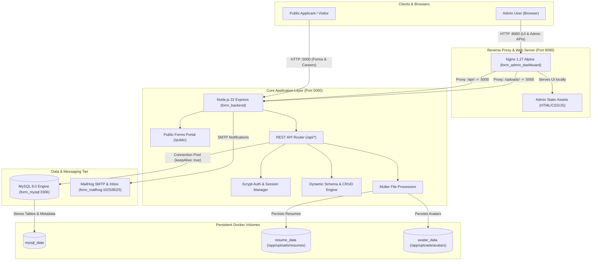
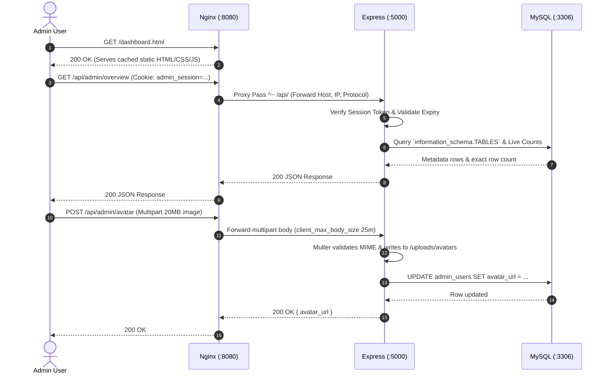
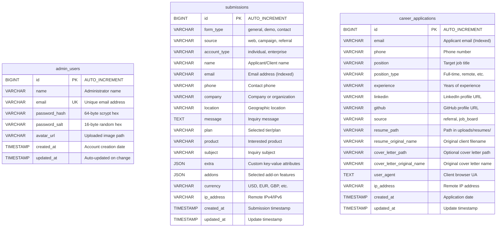
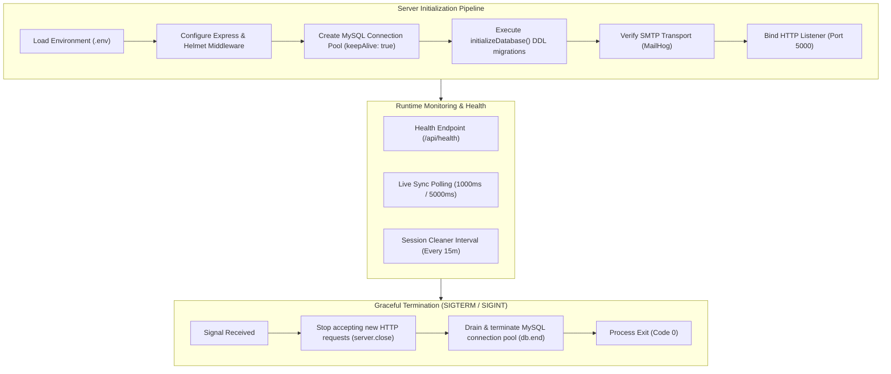

# System Architecture & Technical Design Document

This document provides a comprehensive overview of the **Database Console & Form Management Stack**, detailing the multi-container topology, network traffic routing, database persistence, security boundaries, authentication lifecycles, and front-end state management.

---

## 1. High-Level System Architecture

The application is architected as an isolated, containerized micro-stack orchestrated via Docker Compose. Incoming client traffic is segregated between administrative console actions and public submissions.

---

## 2. Container Topology & Port Distribution

| Container Name | Service Role | Internal Port | Host Port | Underlying Base Image |
| :--- | :--- | :--- | :--- | :--- |
| **`form_admin_dashboard`** | Web Server & Reverse Proxy | `80` | `8080` | `nginx:1.27-alpine` |
| **`form_backend`** | Core Node.js API & Public Forms | `5000` | `5000` | `node:22-alpine` |
| **`form_mysql`** | Relational Database Engine | `3306` | `3306` | `mysql:8.0` |
| **`form_mailhog`** | Mock SMTP Server & Mail UI | `1025` (SMTP), `8025` (Web) | `8025` | `mailhog/mailhog:latest` |

---

## 3. Network Traffic & Reverse Proxy Pipeline

Nginx acts as the single administrative edge gateway (`port 8080`). All requests are routed through strict location rules with specific security headers:

### Key Proxy Rules (`nginx.conf`)
- `client_max_body_size 25m`: Accommodates profile avatar uploads up to 20MB.
- `^~ /api/`: Prefix matching prevents static file regex rules from prematurely intercepting API endpoints.
- `^~ /uploads/`: Safely routes uploaded avatar image requests to the backend with appropriate MIME handling.
- `Cache-Control: "no-store, no-cache, must-revalidate"`: Prevents browser caching of HTML, JS, and CSS during administrative dashboard development and updates.

---

## 4. Security Architecture & Threat Mitigation

```mermaid
flowchart LR
    subgraph EdgeDefenses["Edge & Network Layer"]
        Helmet["Helmet HTTP Headers (nosniff, X-Frame-Options: DENY)"]
        RateLimits["Rate Limiters: authLimiter (15/15min), publicLimiter (30/15min)"]
    end

    subgraph AuthLayer["Authentication & Authorization"]
        Scrypt["crypto.scryptSync (64-byte key, 16-byte crypt salt)"]
        TimingSafe["crypto.timingSafeEqual (Constant-time string comparison)"]
        Cookies["HttpOnly; SameSite=Strict; Path=/; Session Cookie"]
    end

    subgraph DataIntegrity["Data Sanitization & Query Layer"]
        Parametrized["MySQL Prepared Statements (?)"]
        IdentifierEscaping["Identifier Quoting (`table_name`)"]
        TypeWhitelist["SQL Type Whitelist (VARCHAR, INT, TEXT, JSON...)"]
    end

    subgraph StorageSafety["Storage & Content Security"]
        MIMEFinder["Dual MIME + Extension Verification"]
        SVGBlocked["Block SVG Script Execution in Avatars"]
        PrivateResumes["Private Candidate Resumes (No public static route)"]
    end

    EdgeDefenses --> AuthLayer
    AuthLayer --> DataIntegrity
    DataIntegrity --> StorageSafety
```

### 1. Password Storage & Verification
- Hashed using Node.js native `crypto.scryptSync(password, salt, 64)`.
- Salts are 16 bytes of cryptographically secure random bytes generated via `crypto.randomBytes(16)`.
- Comparison uses `crypto.timingSafeEqual` to thwart timing side-channel attacks.

### 2. Session Management & Memory Protection
- Authenticated sessions receive a 256-bit random hex string.
- Sessions are stored in a server-side memory map with an 8-hour Time-To-Live (`ADMIN_SESSION_TTL_MS`).
- A background garbage-collection interval runs every 15 minutes to automatically delete expired sessions, preventing memory leaks.

### 3. Protection Against SQL Injection & Accidental Deletions
- Dynamic table queries wrap all table and column names in `escapeIdentifier()` (`\`name\``).
- Values are injected strictly via prepared statement parameters (`?`).
- Column types are validated against an allowlist in `sanitizeDataType()` before executing schema operations.
- Critical system tables like `admin_users` cannot be dropped via the schema API.

---

## 5. Database Schema & Entity Relationships

---

## 6. Frontend Architecture & Theme Engine

### Theme Switching Mechanism
The admin dashboard features a zero-dependency, CSS-variable-driven theme engine supporting **Light**, **Dark**, and **System Default** modes:

1. **Storage**: The selected mode is stored in `localStorage` under `admin_theme` (`light`, `dark`, or `system`).
2. **DOM Application**: Set on the document root as `data-theme="dark"` or `data-theme="light"`.
3. **OS Synchronization**: When `system` is selected, a listener responds to `window.matchMedia('(prefers-color-scheme: dark)')` events in real-time.
4. **SVG & Icon Filtering**: In dark mode, monochrome PNG icons automatically receive dynamic CSS inversion filters (`filter: brightness(0) invert(0.85);`) to maintain crisp visibility across dark surfaces.

### Interactive Health Donut Mathematics
The Database Health Donut chart renders purely in vector SVG (`#healthDonutSvg`):
- Center coordinates: `(cx=50, cy=50)` with radius `r=38` (circumference $C = 2 \times \pi \times 38 \approx 238.76$).
- Slices calculate proportional arc lengths:
  $$\text{DashLength} = \left(\frac{\text{Percent}}{100}\right) \times C$$
- Each subsequent circle slice applies an offset based on the accumulated percentage:
  $$\text{StrokeOffset} = -\left(\frac{\text{AccumulatedPercent}}{100}\right) \times C$$
- Center metrics and status indicators are rendered transparently above the SVG layer, maintaining complete click-through and hover fidelity.

---

## 7. Lifecycle & Reliability Strategy

1. **Keep-Alive Connection Pool**:
   - `enableKeepAlive: true` and `keepAliveInitialDelay: 10000` send periodic TCP keep-alive probes to the MySQL container, avoiding stale connection errors after long idle periods.
2. **Graceful Teardown**:
   - Intercepts Docker container stops (`SIGTERM`) and manual terminations (`SIGINT`), cleanly waiting for active transactions to complete before closing database sockets.
3. **Error Isolation**:
   - Database syntax errors and connection drops are sanitized in the centralized Express error middleware, returning generic HTTP 400/500 messages to prevent database information disclosure.

